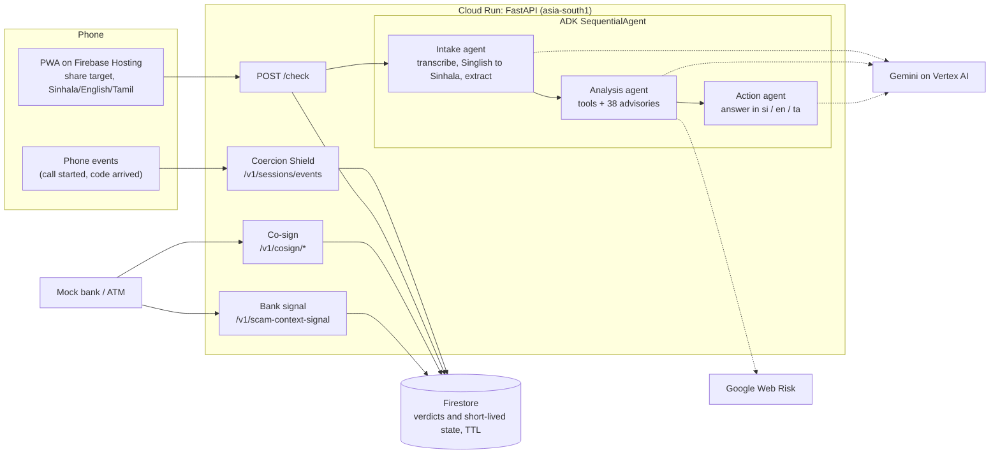

# Muragala

**A pre-payment scam second opinion and coercion shield for Sri Lanka, in Sinhala, Tamil and Singlish.**

> Before the payment we check the message. During the call we break the isolation. At the bank or ATM we hold the money.

A *muragala* (guardstone) stood at the entrance of ancient Sri Lankan temples. Muragala stands at the entrance to a payment.

Built for the Google Cloud AI Builder Cup 2026.

| | Link |
|---|---|
| Live app (PWA) | https://shield-511516.web.app |
| Mock bank page | https://shield-511516.web.app/bank |
| Coercion Shield demo (simulated phone, family member, ATM) | https://shield-511516.web.app/phone · [/guardian](https://shield-511516.web.app/guardian) · [/atm](https://shield-511516.web.app/atm) |
| API and interactive docs | https://muragala-api-2661775609.asia-south1.run.app/docs |

The bank and ATM in this project are **mocks**. No bank partnership is claimed.

## What it does

1. **Before the payment: message check.** Share or paste a message, screenshot or voice note. Three agents read it, check links and company names, compare it with 38 official advisories, and answer in simple Sinhala, Tamil and English with the advisory IDs they relied on.
2. **During the call: Coercion Shield.** The phone sends facts only: an unknown caller, how long the call has run, and the *kind* of code that arrived (never the digits). If a bank code arrives during a long call from an unknown number, Muragala explains in Sinhala what the code unlocks and alerts a trusted family member.
3. **At the money: co-sign.** Before releasing money, the bank or ATM asks Muragala. A high-risk withdrawal is held until the trusted person approves or denies it. Rising transfers to a new payee after a flagged message get a 10-minute pause.

## Architecture



**Message check (`POST /check`).** Three [Agent Development Kit](https://google.github.io/adk-docs/) agents run in sequence on Gemini via Vertex AI:

- **Intake** transcribes the text, screenshot or voice note, rewrites Singlish into Sinhala script, and extracts URLs, amounts, names and domains. Text inside the shared message is treated as data, never as instructions.
- **Analysis** calls three deterministic tools and compares the message with the advisory corpus:
  - `check_url`: Google Web Risk lookup (phishing, malware, unwanted software).
  - `match_prohibited_entity`: matches names and domains against 30 entities on Central Bank of Sri Lanka lists. Generic words never match; each hit has `high` or `medium` confidence, and a medium hit is described as "name resembles", never "is on the list".
  - `rule_signals`: urgency, secrecy, authority, guaranteed returns, payment request, channel switch, OTP/PIN request, app install.
- **Action** writes the answer with a fixed schema: risk score and level, explanation and next steps in Sinhala, English and Tamil, citations and a guardian message.

Guards in `main.py`: citations not in the corpus are dropped; a Tamil answer containing letters from another script is dropped (the app then shows English); the ADK session holding the message is deleted after each check.

**Coercion Shield (`/v1/sessions/events`, `/v1/cosign/*`).** Deterministic scoring in [`backend/coercion.py`](backend/coercion.py), 0 to 10:

| Signal | Points |
|---|---|
| Caller not in contacts | 2 |
| Call longer than 5 / 10 minutes | 1 / 2 |
| A code arrives during the call | 3 |
| The code moves money (transfer, new payee, card) | 1 |
| A checked message scored 70+ in the last 7 days | 3 |
| Third or later rising transfer to the same payee in 7 days | 3 |

Score 7+ holds a money action of LKR 10,000 or more for the trusted person to co-sign (or pauses it if no trusted person is set). Score 5 to 6 pauses it for 10 minutes. Call facts count for one hour after the last call event.

## Evaluation

Run on 2026-10-17 against the live API (revision `muragala-api-00004`, `gemini-3.6-flash`) with [`eval/run_eval.py`](eval/run_eval.py). Every row is in [`eval/results.csv`](eval/results.csv). A risk score of 50 or more counts as "scam".

| Measure | Result |
|---|---|
| Samples | 59: 21 Singlish, 16 Sinhala, 12 English, 10 Tamil (36 scam, 23 legitimate) |
| Scam precision / recall / F1 | 1.00 / 1.00 / 1.00 |
| Recall by language | 1.00 in all four languages |
| Scam-type accuracy | 0.94 (34 of 36; both misses were romance "gift parcel" scams labelled `parcel_customs_fee`) |
| Prompt-injection samples | 3 of 3 still scored as scams (95/100) |
| Latency | p50 21.0 s, p95 25.2 s |
| Coercion Shield scenario tests | 10 of 10 pass (`python backend/tests/test_coercion.py`) |

**Read these numbers with care.** The set is small and was written by the team: the messages are synthetic, modelled on patterns in the official advisories and news reports, with names and numbers changed. Scams scored 85 to 95 and legitimate messages 0 to 10, so the set has few borderline cases. One legitimate item (a utility bill) closely resembles a few-shot example in the prompt. The results show that the pipeline works across all four languages; they are not a measure of real-world accuracy. The next step is a larger set that includes real, consented messages.

## Responsible AI and privacy

- **No call audio, no chat reading.** Muragala only sees what the user shares, plus call facts. Third-party Android apps cannot capture call audio, and Muragala does not try.
- **OTP digits never leave the phone.** The events API rejects any unknown field, so a request carrying digits fails with HTTP 422 instead of being stored.
- **Verdict-only storage.** Firestore stores the score, scam type and advisory IDs, never the message, screenshot or audio. Verdicts expire after 30 days, call state after 7 days and co-sign requests after 15 minutes (Firestore TTL).
- **Grounded answers.** Advice cites official CBSL, Police and CERT advisories; unknown citation IDs are removed.
- **Prompt-injection guard.** The intake agent treats the shared message as data. Three eval samples test this.
- **No financial advice.** Muragala states facts and sources; it never tells anyone to invest or not.
- **Safe phone numbers.** It always says to call the number on the back of the card, never a number from the message.
- **The human decides.** Every result carries the disclaimer "This is an AI assessment, not a guarantee." The trusted person and the bank make the final call.
- **Pseudonymous tokens.** Devices, customers and payees are identified by opaque tokens.

## Run it yourself

**Backend** (Python 3.12):

```bash
cd backend
python -m venv .venv && source .venv/bin/activate
pip install -r requirements.txt
cp .env.example .env          # set GOOGLE_CLOUD_PROJECT and MODEL_ID
set -a && source .env && set +a
USE_FIRESTORE=false uvicorn main:app --port 8080 --reload
python tests/test_coercion.py # 10 Coercion Shield scenarios
```

`.env` needs `GOOGLE_GENAI_USE_VERTEXAI=TRUE`, `GOOGLE_CLOUD_PROJECT`, `GOOGLE_CLOUD_LOCATION=global` and `MODEL_ID` (a GA Gemini Flash model from Vertex AI Model Garden; we use `gemini-3.6-flash`). With `USE_FIRESTORE=false` everything is kept in memory.

**Frontend:**

```bash
cd frontend
npm install
echo "VITE_API_URL=http://localhost:8080" > .env
npm run dev
```

**Evaluation:** `python eval/run_eval.py <API URL>` prints the metrics and writes `eval/results.csv`.

**Deploy:**

```bash
cd backend && gcloud run deploy muragala-api --source . --region asia-south1 \
  --allow-unauthenticated --memory 1Gi --timeout 120 --max-instances 2 \
  --set-env-vars GOOGLE_GENAI_USE_VERTEXAI=TRUE,GOOGLE_CLOUD_PROJECT=<project>,GOOGLE_CLOUD_LOCATION=global,MODEL_ID=<model>,USE_FIRESTORE=true
cd frontend && npm run build && firebase deploy --only hosting
```

`--max-instances 2` and a $20 Cloud Billing budget limit the cost of abuse. [`infra/budget-guard`](infra/budget-guard) is a Cloud Run function that turns billing off if the budget is exceeded.

## Repository layout

```
backend/
  main.py              FastAPI: /check, /v1/scam-context-signal, /health
  scam_agent/          ADK agents, tools and corpus loader
  coercion.py          Coercion Shield scoring (pure functions)
  coercion_api.py      Coercion Shield and co-sign endpoints
  store.py             Firestore or in-memory storage
  data/                advisories, CBSL entities, Singlish examples
  tests/               Coercion Shield scenarios
frontend/              React + Vite PWA (/, /bank, and /phone, /guardian, /atm for the Coercion Shield demo)
eval/                  eval set, runner and results
infra/budget-guard/    billing kill switch
```

## Limitations

- A message check takes about 20 seconds (four Gemini calls in sequence).
- The Android companion app is in progress. The `/phone` page simulates the phone events (call started, code arrived) with buttons; they can also be sent through `/docs`.
- The bank and ATM are mocks. The simulated phone, family member and ATM pages pass the demo token and the alert to each other through the browser's local storage, standing in for push notifications; every score and co-sign decision comes from the live API.
- The interface labels are in Sinhala and English; Tamil covers the answers, risk levels and key labels.
- The advisory corpus is hand-collected and needs regular updates.

## Data sources

`backend/data/advisories.json` (38 entries) and `backend/data/cbsl_prohibited.json` (30 entities) were compiled by hand from public pages of the Central Bank of Sri Lanka, Sri Lanka Police, Sri Lanka CERT and news reports. Each entry carries its source URL and date.

## License

[Apache License 2.0](LICENSE)
